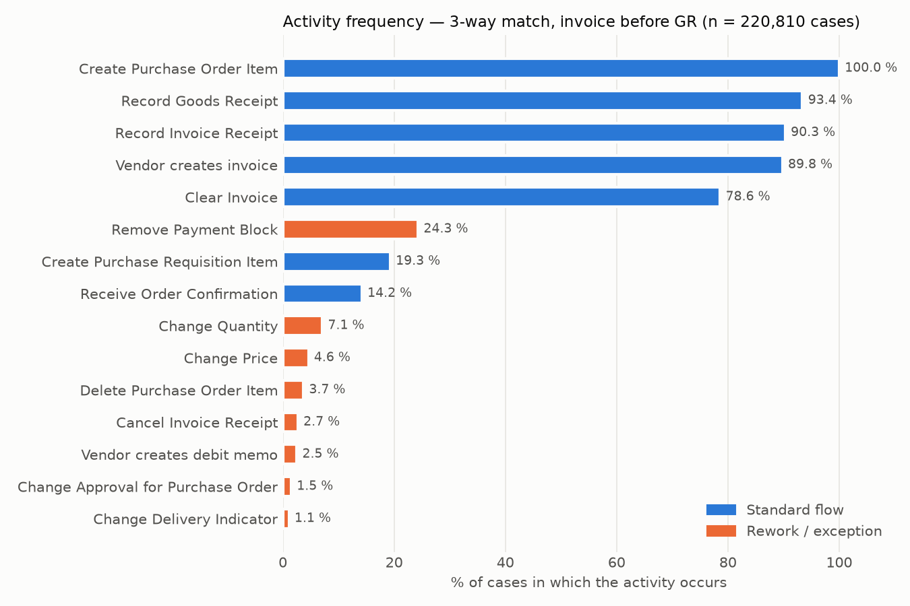

# Where do purchases get stuck? — P2P bottleneck analysis (BPI Challenge 2019)

> 🚧 Work in progress — final version: December 2026.

## Business question
A multinational processes ~250,000 purchase order items a year in SAP (order → goods receipt → invoice → payment).
**At which step do purchases get stuck, and how much does that cost the company?**

## Data
[BPI Challenge 2019](https://doi.org/10.4121/uuid:d06aff4b-79f0-45e6-8ec8-e19730c248f1): real purchase-to-pay event log of a large coatings & paints company, extracted from SAP. 251,734 cases · 1.6 M events · 42 activities. License CC BY 4.0. See [`data/README.md`](data/README.md) to reproduce.

## Approach
| # | Notebook | Question | Status |
|---|----------|----------|--------|
| 1 | [Data understanding & validation](01_data_understanding.ipynb) | What is in the log, and is it reliable? | ✅ |
| 2 | Process discovery | What does the real process look like? | ⏳ |
| 3 | Bottleneck & rework | Where is time lost? | ⏳ |
| 4 | Business impact | How much does it cost (€)? | ⏳ |

## Findings so far
- **87.8 %** of items follow the *3-way match, invoice before GR* flow → scope of the analysis (220,810 cases after cleaning).
- **24.3 %** of in-scope cases require a manual *Remove Payment Block* — the invoice arrives before the goods and payment is blocked. Main bottleneck candidate.
- Further rework: *Change Quantity* (7.1 %) and *Change Price* (4.6 %) after the order is placed.
- 320 events (0.02 %) with impossible dates (1948, 2020…) were excluded.

## Where this data lives in SAP
*(to be completed: EBAN, EKKO/EKPO, EKBE, RBKP/RSEG, CDHDR/CDPOS)*

## Tools
Python · pandas · PM4Py · DuckDB (SQL) · matplotlib · Jupyter
